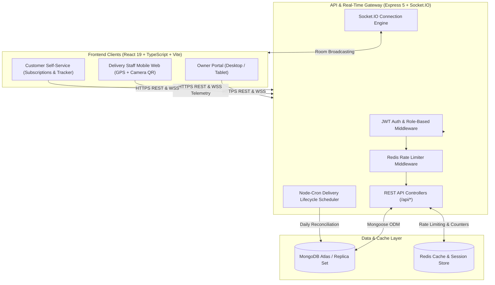

<div align="center">

# 🥛 Dairix

**Smart Dairy Subscription & Real-Time Delivery Logistics Platform**

An end-to-end full-stack platform built for modern dairy enterprises, independent milk distributors, delivery staff, and daily subscribers. Streamline morning dispatches, track driver GPS sessions in real time, verify deliveries through camera QR scanning, and manage recurring customer milk subscriptions with automated billing.

[](https://react.dev/)
[](https://www.typescriptlang.org/)
[](https://vitejs.dev/)
[](https://tailwindcss.com/)
[](https://nodejs.org/)
[](https://expressjs.com/)
[](https://www.mongodb.com/)
[](https://socket.io/)
[](https://redis.io/)
[](LICENSE)

<br/>

<!-- ========================================================================= -->
<!-- PLACEHOLDER: HERO / PLATFORM OVERVIEW BANNER                             -->
<!-- Replace 'https://via.placeholder.com/...' with your actual banner image   -->
<!-- Example path: docs/images/hero-banner.png                                 -->
<!-- ========================================================================= -->
<p align="center">
  
</p>

[Features](#-key-features) • [Architecture](#-system-architecture) • [Quick Start](#-quick-start) • [Role Breakdown](#-role-based-experience) • [API & Sockets](#-real-time-socket-events) • [Demo Credentials](#-demo-credentials)

</div>

---

## 📋 Table of Contents

- [Overview](#-overview)
- [Key Features](#-key-features)
- [Role-Based Experience](#-role-based-experience)
  - [1. Business Owner Portal](#1-business-owner-portal)
  - [2. Delivery Staff (DM) Application](#2-delivery-staff-dm-application)
  - [3. Customer Subscription Portal](#3-customer-subscription-portal)
- [System Architecture](#-system-architecture)
- [Tech Stack](#-tech-stack)
- [Real-Time Socket Events](#-real-time-socket-events)
- [Screenshots & UI Showcase](#-screenshots--ui-showcase)
- [Getting Started](#-getting-started)
  - [Prerequisites](#prerequisites)
  - [1. Clone Repository](#1-clone-repository)
  - [2. Start Supporting Services (Redis)](#2-start-supporting-services-redis)
  - [3. Backend Configuration & Setup](#3-backend-configuration--setup)
  - [4. Frontend Configuration & Setup](#4-frontend-configuration--setup)
  - [5. Seed Realistic Delivery Data](#5-seed-realistic-delivery-data)
- [Demo Credentials](#-demo-credentials)
- [Available Scripts](#-available-scripts)
- [Delivery Lifecycle & Timezone Rules](#-delivery-lifecycle--timezone-rules)
- [Contributing & License](#-contributing--license)

---

## 🌟 Overview

Fresh milk delivery is time-critical: distribution rounds start at 5:00 AM, thousands of customer deliveries occur within hours, and inaccurate records lead to route confusion and billing disputes.

**Dairix** solves these operational bottlenecks by providing:
1. **Automated Morning Dispatches:** Aggregates recurring subscriptions per delivery partner into concise load allocations.
2. **Live Fleet Telemetry:** Streams delivery driver location, speed, and heading directly onto an interactive Leaflet map using WebSockets.
3. **Doorstep QR Verification:** Delivery partners scan customer door QR codes with device cameras for instantaneous status confirmation.
4. **Subscriber GPS Pinning:** Customers pin their delivery drop point with high-precision geolocation and specific delivery instructions (e.g. *"drop in door hook"*).
5. **Automated Reconciliation:** Nightly cron jobs transition uncompleted deliveries according to strict cutoff rules in the `Asia/Kolkata` timezone.

---

## ⚡ Key Features

- **🗺️ Interactive Live Delivery Map**: Full Leaflet-powered GIS map displaying real-time delivery partner positions, path telemetry, customer drop-off pins, and delivery status clusters.
- **📷 Camera QR Scanner**: Zero-hardware camera scanner built on ZXing for sub-second package hand-off verification.
- **🔄 WebSocket State Synchronization**: Multi-tenant Socket.IO room architecture instantly updates Owner, Delivery Partner, and Customer views the millisecond an item is delivered.
- **📊 Business Intelligence & Analytics**: Interactive charts using Recharts for daily milk volume, delivery completion rates, and weekly revenue metrics.
- **🛡️ Enterprise Multi-Tenancy & RBAC**: Strict business-level data isolation with JWT role-based access control (`owner`, `dm`, `customer`).
- **⏱️ Automated Lifecycle Cron**: Scheduled nightly jobs safely mark expired pending deliveries as `skipped` without corrupting live delivery days.
- **📍 Precise Delivery Coordinates**: Validated geographic coordinates with fallback calculations and neighborhood mapping.

---

## 👥 Role-Based Experience

### 1. Business Owner Portal
Designed for dairy business operators to oversee whole-chain logistics from processing to customer doorstep.

- **Morning Dispatch Builder**: Auto-calculate product volumes needed per delivery staff based on active customer subscriptions.
- **Live Dispatch Board**: Track real-time status of all daily rounds (`created`, `assigned`, `completed`).
- **Live Fleet Tracking**: Observe drivers in motion, active session durations, and customer destination markers.
- **Customer & Staff Management**: Add delivery personnel, assign delivery partners to customer accounts, and modify subscription plans.
- **Catalogue & Pricing Control**: Manage milk varieties (Cow, Buffalo, A2, Toned), milk products (Ghee, Paneer, Butter, Chaas), prices, and units.

### 2. Delivery Staff (DM) Application
A mobile-first progressive interface optimized for fast outdoor delivery rounds.

- **One-Tap "Start Delivering" Session**: Broadcasts high-accuracy GPS coordinates to the owner control room.
- **Daily Route Dashboard**: Displays total assigned stops, completed count, remaining drops, and real-time completion percentage.
- **Quick Customer Actions**: Direct phone dialing (`tel:`) and one-click Google Maps navigation to customer drop pins.
- **In-App QR Scanner**: Built-in camera scanner scans customer QR codes to verify dropoffs and log delivery timestamps.
- **Cash & Collections Tracker**: Record cash and digital collections on the go.

### 3. Customer Subscription Portal
A self-service hub for residential milk subscribers.

- **Doorstep QR Code**: Dedicated high-contrast digital QR code readable by delivery staff through low-light conditions.
- **GPS Destination Pinning**: Interactive browser geolocation captures exact delivery drop coordinates with meter-accuracy indicators.
- **Subscription Management**: Add, adjust, pause, or resume milk subscriptions with daily quantity adjustments.
- **Live Delivery Status**: Immediate visual indicators (`Pending`, `Out for Delivery`, `Delivered`, `Skipped`) with timestamps.
- **Delivery Tracker**: Weekly and monthly delivery history view with itemized records and billing totals.

---

## 🏗️ System Architecture



---

## 💻 Tech Stack

### Frontend
| Technology | Version | Purpose |
| :--- | :--- | :--- |
| **React** | `^19.2.7` | UI library for reactive, component-driven interfaces |
| **TypeScript** | `~6.0.2` | Type-safety, strict interfaces, and developer ergonomics |
| **Vite** | `^8.1.1` | Next-generation build tool with instant HMR |
| **Tailwind CSS** | `^4.3.2` | Modern utility-first styling engine |
| **Leaflet & React Leaflet** | `^1.9.4` | Interactive live mapping and driver marker rendering |
| **Recharts** | `^3.9.2` | Responsive data visualization and delivery volume charts |
| **ZXing Browser** | `^0.2.1` | Multi-format barcode & QR camera recognition |
| **Lucide React** | `^1.23.0` | Comprehensive iconography |
| **Socket.IO Client** | `^4.8.4` | Low-latency bi-directional WebSocket client |
| **React Router** | `^7.18.1` | Role-guarded application routing |

### Backend
| Technology | Version | Purpose |
| :--- | :--- | :--- |
| **Node.js** | `>=20.0.0` | Server runtime environment |
| **Express** | `^5.2.1` | Web application framework and REST routing |
| **MongoDB & Mongoose** | `^9.7.3` | Document database and ODM schemas |
| **Socket.IO** | `^4.8.4` | Real-time WebSocket communications server |
| **Redis** | `^6.1.0` | High-performance in-memory cache and rate limiting |
| **Node-Cron** | `^4.6.0` | Automated delivery lifecycle reconciliation |
| **Bcrypt** | `^6.0.0` | Password hashing and security |
| **JSON Web Tokens (JWT)** | `^9.0.3` | Stateless authentication stored in HTTP-only cookies |
| **Zod** | `^4.4.3` | Runtime schema validation |

---

## 📡 Real-Time Socket Events

Dairix uses scoped Socket.IO rooms for targeted event delivery:

| Event Name | Direction | Payload | Description |
| :--- | :---: | :--- | :--- |
| `delivery:session:start` | DM ➔ Server | `{ dmId, name, latitude, longitude }` | Initiates live delivery session |
| `delivery:location:update` | DM ➔ Server | `{ latitude, longitude, heading, speed }` | Streams periodic driver GPS coordinates |
| `delivery:session:stop` | DM ➔ Server | `{ dmId }` | Concludes active delivery round |
| `delivery:sessions:active` | Server ➔ Owner | `Array<ActiveDeliverySession>` | Initial snapshot of all active drivers |
| `delivery:entry:updated` | Server ➔ All | `{ entryId, customerId, dmId, status, deliveredAt }` | Emitted when delivery status changes |

---

## 📸 Screenshots & UI Showcase

<!-- ========================================================================= -->
<!-- PLACEHOLDERS: UI SCREENSHOTS                                              -->
<!-- Replace the image URLs below with your exported application screenshots. -->
<!-- Recommended folder: docs/images/                                         -->
<!-- ========================================================================= -->

<div align="center">

### Owner Operations & Fleet Map
<p align="center">
  
</p>
<p><i>Live delivery tracking map featuring driver GPS markers, customer destination pins, and delivery status filters.</i></p>

---

### Delivery Partner Mobile Workflow
<p align="center">
  
  &nbsp;&nbsp;&nbsp;&nbsp;
  
</p>
<p><i>Left: Integrated camera QR code scanner. Right: Daily assigned route progress and customer stop cards.</i></p>

---

### Customer Portal & GPS Destination Pinning
<p align="center">
  
</p>
<p><i>Subscribers can update delivery instructions, track weekly drops, and capture pinpoint GPS coordinates.</i></p>

</div>

---

## 🚀 Getting Started

Follow these step-by-step instructions to set up Dairix locally.

### Prerequisites

Ensure you have installed:
- [Node.js](https://nodejs.org/) (`v20.x` or higher recommended)
- [npm](https://www.npmjs.com/) (bundled with Node.js)
- [Docker](https://www.docker.com/) (for Redis support) or a standalone Redis server
- A [MongoDB Atlas](https://www.mongodb.com/atlas) connection URI or local MongoDB daemon

---

### 1. Clone Repository

```bash
git clone https://github.com/dangerousEnigma1827/Dairix.git
cd Dairix
```

---

### 2. Start Supporting Services (Redis)

Start the lightweight Redis container using the provided `docker-compose.yml`:

```bash
docker compose up -d
```

Verify Redis is active:
```bash
docker ps --filter "name=dairix-redis"
```

---

### 3. Backend Configuration & Setup

1. Navigate to the `server` directory and install dependencies:
   ```bash
   cd server
   npm install
   ```

2. Configure environment variables by creating `.env`:
   ```bash
   cp .env.example .env
   ```

3. Update `.env` with your settings:
   ```env
   MONGO_URI=mongodb+srv://<username>:<password>@cluster0.mongodb.net/Dairix
   CLIENT_ORIGIN=http://localhost:5173
   REDIS_URL=redis://localhost:6379
   PORT=5000
   NODE_ENV=development
   JWT_SECRET=your_super_secret_jwt_key
   ```

4. Start the backend development server:
   ```bash
   npm start
   ```
   *The server runs at [http://localhost:5000](http://localhost:5000)*

---

### 4. Frontend Configuration & Setup

1. Open a new terminal, navigate to the `client` directory and install dependencies:
   ```bash
   cd client
   npm install
   ```

2. Configure frontend environment variables by creating `.env`:
   ```bash
   cp .env.example .env
   ```

3. Verify `.env` values:
   ```env
   VITE_API_BASE_URL=http://localhost:5000/api
   VITE_SOCKET_URL=http://localhost:5000
   ```

4. Launch Vite development server:
   ```bash
   npm run dev
   ```
   *The application will be accessible at [http://localhost:5173](http://localhost:5173)*

---

### 5. Seed Realistic Delivery Data

Dairix includes built-in database seeding utilities that set up a realistic operational environment without manual entry:

#### Comprehensive 14-Day Baseline Seed
Seeds 14 products, 18 delivery men, 60 customers with GPS coordinates, and two weeks of historical dispatches:
```bash
cd server
node seed.js
```

#### Seed Today's Delivery Rounds & Allocations
Creates today's morning dispatch record with mixed delivery statuses (`delivered` vs `pending` ongoing round) and exact product quantity consistency:
```bash
cd server
node seed_today_deliveries.mjs
```

#### Enable Delivery Partner Addresses
Ensures all delivery partner profiles have verified, active addresses persisted to MongoDB:
```bash
cd server
node enable_all_dm_addresses.mjs
```

#### Run Automated Verification Suite
Validates dispatch allocations, delivery entries, dashboard metrics, and historical integrity:
```bash
cd server
node verify_all.mjs
```

---

## 🔑 Demo Credentials

All test accounts share the common password: **`1`**

| Role | Name | Mobile Number | Password | Key Capabilities |
| :--- | :--- | :--- | :---: | :--- |
| **Owner** | Muneeb | `9999999999` | `1` | Live Map, Dispatches, Analytics, Staff Management |
| **Delivery Staff** | Ramesh Kumar | `9888888888` | `1` | 4 assigned customers (75% completed round) |
| **Delivery Staff** | Suresh Sharma | `9820010002` | `1` | 3 assigned customers (100% completed round) |
| **Delivery Staff** | Harish Mishra | `9820010018` | `1` | 3 assigned customers (ongoing morning round) |
| **Customer** | Aarav Sharma | `9810010001` | `1` | Cow Milk subscriber, door drop note, doorstep QR |
| **Customer** | Priya Patel | `9810010002` | `1` | Full Cream subscriber, GPS delivery pin |

---

## 🛠️ Available Scripts

### Backend (`server/`)
- `npm start` — Runs the Express and Socket.IO server with Nodemon / Node.
- `npm test` — Executes the Jest & Supertest test suite.
- `node seed.js` — Seeds catalogue, staff, customers, and 14 days of delivery history.
- `node seed_today_deliveries.mjs` — Seeds today's realistic morning dispatch and mixed deliveries.
- `node enable_all_dm_addresses.mjs` — Authenticates each DM and enables their addresses.
- `node verify_all.mjs` — Runs the 32-point end-to-end operational verification suite.

### Frontend (`client/`)
- `npm run dev` — Starts Vite dev server with Hot Module Replacement at `localhost:5173`.
- `npm run build` — Runs TypeScript compile (`tsc -b`) and generates production bundle in `dist/`.
- `npm run preview` — Locally previews the generated production build.
- `npm run lint` — Runs ESLint across all TypeScript and React files.

---

## ⏰ Delivery Lifecycle & Timezone Rules

Dairix enforces timezone-safe business logic pinned to **`Asia/Kolkata` (IST, UTC+05:30)**:

1. **Delivery Day Window**: Starts at `00:00:00.000 IST` and reaches cutoff at `23:59:59.999 IST`.
2. **Pending State**: Uncompleted deliveries for the active delivery day remain strictly `pending` so delivery staff can finish rounds without false failures.
3. **Skipped State**: An uncompleted delivery transitions to `skipped` **only after** the delivery day cutoff passes via the midnight reconciliation cron.
4. **Delivered State**: Delivered records capture exact timestamps (`deliveredAt`) and cannot be retroactively skipped.

---

## 📂 Project Directory Structure

```text
Dairix/
├── docker-compose.yml              # Local Redis service configuration
├── README.md                       # Repository documentation
├── client/                         # React 19 + TypeScript + Vite frontend
│   ├── .env.example                # Sample frontend environment config
│   ├── src/
│   │   ├── api/                    # Axios REST client & Socket.IO singleton
│   │   │   └── Services/           # Modular services (Owner, DM, Customer, Auth)
│   │   ├── components/             # Reusable UI components & LiveDeliveryMap
│   │   ├── context/                # User authentication context
│   │   ├── hooks/                  # Delivery tracking & geolocation hooks
│   │   ├── pages/
│   │   │   ├── Owner/              # Owner portal (Dashboard, Dispatches, Staff)
│   │   │   ├── Dm/                 # Delivery staff portal (Scan & Deliver, Route)
│   │   │   └── Customer/           # Customer portal (Subscriptions, QR, Tracker)
│   │   ├── Types/                  # TypeScript interfaces and domain models
│   │   └── App.tsx                 # Protected route hierarchy
│   └── package.json
└── server/                         # Express 5 + MongoDB backend
    ├── .env.example                # Sample backend environment config
    ├── server.js                   # Server bootstrap & socket initialization
    ├── app.js                      # Express middleware, CORS, & route registry
    ├── config/                     # Database, Redis, and Socket.IO configurations
    ├── controllers/                # Business logic separated by role
    ├── models/                     # Mongoose schemas (User, Product, Dispatch, Entry)
    ├── routes/                     # Role-guarded Express route definitions
    ├── socket/                     # Delivery session handlers & real-time sync
    ├── jobs/                       # Nightly delivery reconciliation cron jobs
    ├── seed_today_deliveries.mjs   # Seed utility for today's deliveries
    ├── enable_all_dm_addresses.mjs # Utility to authenticate & activate DM addresses
    ├── verify_all.mjs              # Automated 32-assertion verification script
    └── package.json
```

---

## 🤝 Contributing

Contributions to Dairix are welcome!

1. Fork the Project
2. Create your Feature Branch (`git checkout -b feature/AmazingFeature`)
3. Commit your Changes (`git commit -m 'Add some AmazingFeature'`)
4. Push to the Branch (`git push origin feature/AmazingFeature`)
5. Open a Pull Request

---

## 📄 License

Distributed under the **ISC License**. See `LICENSE` for more information.

<div align="center">
  <sub>Built with ❤️ by Syed Muneeb & the Dairix Team.</sub>
</div>
